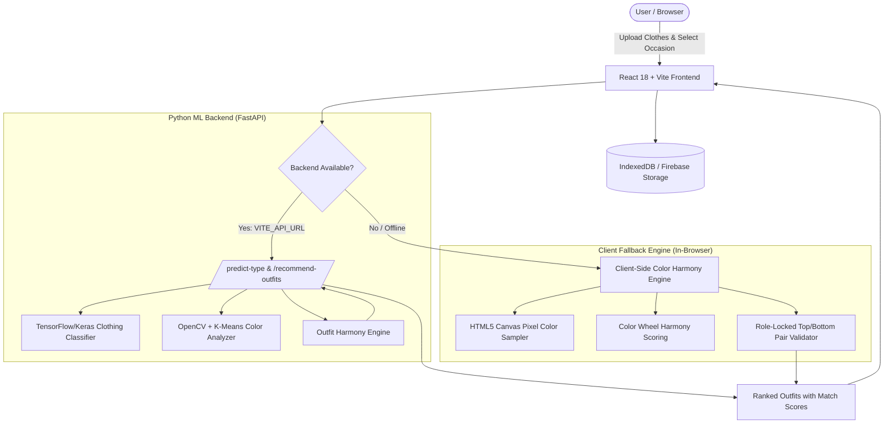

# 👔 Clazzy — AI-Powered Outfit Recommendation App

> **Your intelligent fashion companion that generates optimal outfit combinations with color harmony algorithms and wardrobe pairing for any occasion.**

[](https://github.com/mohamedirsath07/Clazzy/actions/workflows/ci.yml)
[](https://clazzyai.vercel.app)
[](https://www.typescriptlang.org/)
[](https://reactjs.org/)
[](https://www.python.org/)
[](https://fastapi.tiangolo.com/)
[](https://opensource.org/licenses/MIT)

---

## 🌐 Live Application
- **Production URL:** [https://clazzyai.vercel.app](https://clazzyai.vercel.app)
- **Installable PWA:** Works on mobile and desktop offline or online with local storage caching.

---

## 🏛️ System Architecture

Clazzy uses a resilient **Dual-Engine Architecture**:
1. **Cloud / Local ML Mode**: Connects to the FastAPI backend with TensorFlow/Keras binary classification and K-means color extraction.
2. **Client-Side Color Theory Fallback**: When deployed in serverless/static environments (like Vercel) or when the user is offline, an in-browser color harmony engine (HSV/HSL analysis, complementary/analogous pairing, aspect-ratio heuristics) takes over with zero latency.



---

## ✨ Core Features

### 📱 Progressive Web App (PWA)
- Installable directly to home screen on iOS and Android.
- Service Worker caching strategy for instant subsequent reloads.

### 🎨 Color Harmony Scoring
Evaluates clothing pairing using fundamental color wheel geometry:
- **Complementary (150°–210°)**: ~95% base harmony.
- **Monochromatic & Neutrals**: ~88% base harmony (neutrals pair safely with all palettes).
- **Analogous (0°–45°)**: ~86% harmonious transition.
- **Triadic & Split-Complementary**: ~82%–84% balanced contrast.

### 🎯 Occasion-Based Filtering
- **Formal / Business**: Penalizes casual wear and boosts structured shirts with dark trousers.
- **Sports**: Prioritizes breathable activewear.
- **Party**: Rewards higher saturation and vibrant contrast.
- **Casual / Everyday**: Balanced, all-around harmony scoring.

### 💾 Persistent Local Collection
- Wardrobe library management with instant image preview.
- IndexedDB storage for offline wardrobe persistence without mandatory logins.
- Optional Firebase Cloud storage support.

---

## 🚀 Getting Started

### Prerequisites
- **Node.js** v18+ (Node 20+ recommended)
- **Python** 3.10+
- **npm** or **pnpm**

### 1. Clone & Setup Environment

```bash
git clone https://github.com/mohamedirsath07/Clazzy.git
cd Clazzy

# Copy safe environment configuration template
cp .env.example .env
```

### 2. Frontend Setup

```bash
# Install frontend dependencies
npm install

# Run frontend in development mode
npm run dev:client
```
The frontend will start at `http://localhost:5173`.

### 3. Backend Setup (Optional for Full ML Pipeline)

```bash
cd backend

# Create and activate virtual environment
python -m venv .venv
# Windows:
.venv\Scripts\activate
# macOS/Linux:
source .venv/bin/activate

# Install backend dependencies
pip install -r requirements.txt

# Start FastAPI server
python main.py
```
The FastAPI backend will start at `http://localhost:8000` (API documentation available at `http://localhost:8000/docs`).

---

## 🧪 Testing

Clazzy includes comprehensive test coverage for both frontend color harmony scoring and backend outfit recommendation engines:

```bash
# Run Frontend Unit Tests (Node test runner + TSX)
npm test

# Run Python Backend Tests (Pytest)
npm run test:backend
```

---

## 📂 Repository Structure

```
Clazzy/
├── .github/
│   ├── workflows/ci.yml       # GitHub Actions CI workflow
│   └── CONTRIBUTING.md        # Contributor guidelines
├── backend/
│   ├── main.py                # FastAPI server & route handlers
│   ├── color_analyzer.py      # K-means color extraction
│   ├── ml_classifier.py       # Keras classification interface
│   ├── outfit_recommender.py  # Occasion & color pairing logic
│   ├── emergency_recommender.py # Deterministic fallback recommender
│   ├── train_classifier.py    # Training script to rebuild classifier
│   ├── tests/                 # Pytest backend test suite
│   └── requirements.txt       # Python dependencies
├── client/
│   ├── public/                # Static assets, PWA icons, robots.txt, sitemap.xml
│   ├── src/
│   │   ├── components/        # React UI components & ErrorBoundary
│   │   │   └── ui/            # Curated shadcn/ui primitives
│   │   ├── lib/
│   │   │   ├── colorAnalysis.ts    # Color theory & HSL algorithms
│   │   │   ├── outfitRecommender.ts # Heuristics & pairing logic
│   │   │   ├── mlTypes.ts          # Core TypeScript definitions
│   │   │   └── mlApi.ts            # Orchestration & API communication
│   │   └── pages/
│   │       └── Home.tsx       # Main step wizard interface
│   └── index.html             # Accessible viewport, SEO tags, JSON-LD
├── .env.example               # Environment variables template
├── package.json
└── vite.config.ts
```

---

## 🔒 Security & Secrets Management

- Database connection strings, cloud storage tokens, and backend endpoints are managed strictly through environment variables (`.env`).
- Never commit actual secrets or production credentials to git. Refer to `.env.example` for required configuration keys.

---

## 🤝 Contributing

Contributions, bug reports, and suggestions are welcome! Please review [CONTRIBUTING.md](.github/CONTRIBUTING.md) for contribution guidelines and conventional commit practices.

---

## 📄 License

This project is licensed under the [MIT License](LICENSE).